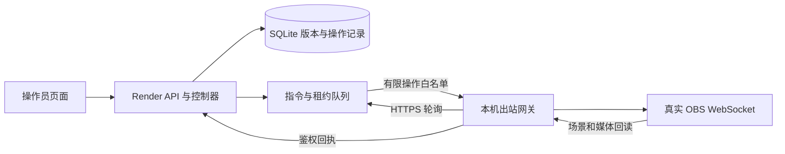

# 演出自动化架构与技术取舍

两个项目独立部署、独立数据库、独立权限。可以配置相同模型供应商，但不共享业务状态。

本机运行可以直接连接 OBS，Render 采用网关模式。两个路径复用同一个 ObsDriver，不向浏览器暴露 OBS 密码。网关仅执行状态、专用场景准备、场景切换、媒体状态和截图操作。

控制器使用不可变发布快照和持久化操作键。执行前保存 pending 意图，只有回读符合目标才推进 cursor。丢失回执时恢复流程检查实际场景；已到目标场景则登记恢复确认，不再次切换。

自动时间轴使用服务器时钟和约 200 ms 调度周期。暂停恢复时平移起始时刻，避免后续 cue 被跳过或集中补发。最后一段媒体状态为 ENDED 后才结束整场。服务重启会暂停活动场次，不能自动假定现场状态。

直接切换使用 OBS cut_transition，避免异步淡入淡出造成旧媒体仍活跃而未重新激活。媒体解码状态允许有限轮询，不重复发送切换指令。

网关的结果缓存与服务器幂等键只能降低重复风险，不能宣称跨机器的严格 exactly-once。网络分区时以暂停和人工确认保证可解释的恢复行为。

灯光、调音和实体摄像机未接入。本机素材不是 AI 视频；其作用是验证真实软件播放和控制。

## 成本与扩展

本机模型使用已下载的 Qwen2.5 1.5B Q4_K_M 与 llama.cpp CPU 推理，不产生供应商 API 调用费用，但占用本机计算和内存。Render 版本需要另配远程模型服务。

模型费用按“输入 token 数 × 输入单价 + 输出 token 数 × 输出单价”计算，单位需与供应商计价一致；不在项目中写死未验证的价格。Render 服务、磁盘和模型费用由部署时所选方案决定。

当前所有性能数字都是本机样板的实测，不代表高并发、复杂媒体或跨公网链路的性能保证。
